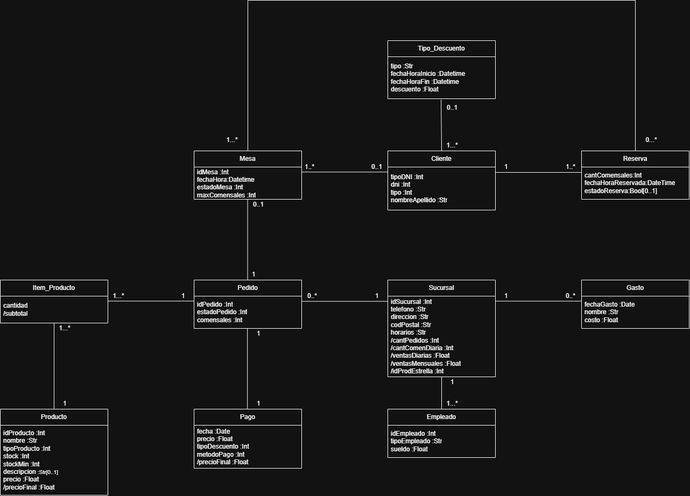

# Propuesta TP DSW

## Grupo
### Integrantes
* 54175 - Bucher, Guadalupe Aylen
* 54547 - Crispo, Ignacio Martín
* 53953 - Rossi Avonto, Dariana
* 55061 - Sacchetti, Camila Maylén

### Repositorios
* [fullstack app](https://github.com/dari-rossi/LaPasteleria/tree/main/Programa)

## Tema - La Pastelería
### Descripción
* La Pastelería es una cafetería ubicada en la ciudad de Rosario que ofrece servicios de cafetería durante el día y bar por la noche en una de sus sucursales. Su funcionamiento se basa en la atención al cliente mediante reservas, asignación de mesas y toma de pedidos online, con control de stock en tiempo real. El negocio busca mejorar la gestión de productos, ventas y finanzas a través de un sistema integrado.

### Modelo

## Alcance Funcional 

### Alcance Mínimo

Regularidad:
|Req|Detalle|
|:-|:-|
|CRUD simple|1. CRUD Sucursal 2. CRUD Producto 3. CRUD Tipo Empleado 4. CRUD Mesa|
|CRUD dependiente|1. CRUD Reserva {depende de} CRUD Mesa 2. CRUD Gasto {depende de} CRUD Sucursal|
|Listado + detalle|1. Listado de advertencia de stock bajo filtrado por sucursal. Muestra el nombre del producto, la cantidad restante y la sucursal. 2. Listado de productos filtrado por tipo de producto, cantidad de stock y popularidad. Muestra nombre, descripción del producto y stock mínimo.|
|CUU/Epic|1. Registrar reserva para cliente 2. Cargar pedido|

Adicionales para Aprobación
|Req|Detalle|
|:-|:-|
| **CRUD** | 1. CRUD Pago 2. CRUD Item Producto 3. CRUD Pedido 4. CRUD Inventario 5. CRUD Sucursal Tipo Empleado |
| **CUU/Epic** | 1. Cargar pedido de stock 2. Registrar Pago |

### Alcance Adicional Voluntario

|Req|Detalle|
|:-|:-|
|Listados|1. Listado de reservas filtrado por sucursal, fecha y cantidad de personas. Muestra fecha y horario, cantidad de comensales y la sucursal de la reserva.|